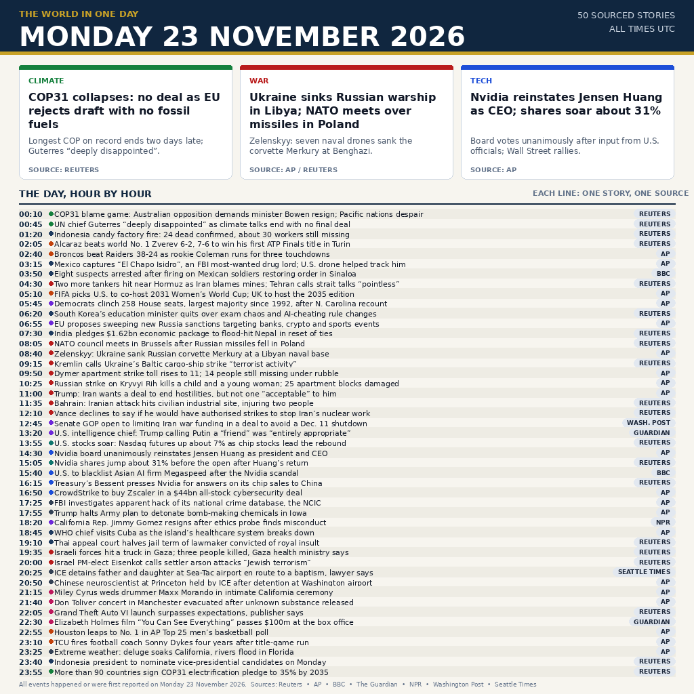

# World news, 23 November 2026

[](https://make.fun/bounty/news-image-20261123)
[](https://make.fun/bounty/news-image-20261123)
[](https://make.fun/bounty/news-image-20261123)

One image that sums up the world's news of **Monday 23 November 2026**:
three lead stories — the COP31 climate talks collapsing with no deal,
Ukraine sinking a Russian warship in Libya as NATO meets over Russian
missiles in Poland, and Nvidia reinstating Jensen Huang as CEO — plus a
UTC timeline of 47 more sourced stories, one story per line, each with its
source. 50 stories in total, from Reuters, AP, BBC, The Guardian, NPR,
the Washington Post and the Seattle Times.



## How it was built

`draw.py` (Python + Pillow) draws the 1024×1024 image deterministically
from a fixed, sourced story list — no network, no randomness — and writes
`entry.png`. `main.ts` (Node standard library only) simply copies the
committed `entry.png` to the output directory, so both runs of the program
produce identical bytes.

```sh
python3 draw.py            # regenerate entry.png (deterministic)
MAKEFUN_OUTPUT_DIR=out node main.ts   # copy it to out/entry.png
```

## Entry

- Competition: [news-image-20261123](https://make.fun/bounty/news-image-20261123)
  on [make.fun](https://make.fun) — "Sum up 23 November's world news in one image"
- Referral code: `hv9zk8y5` — https://make.fun/r/hv9zk8y5

## License

MIT — see [LICENSE](LICENSE).
